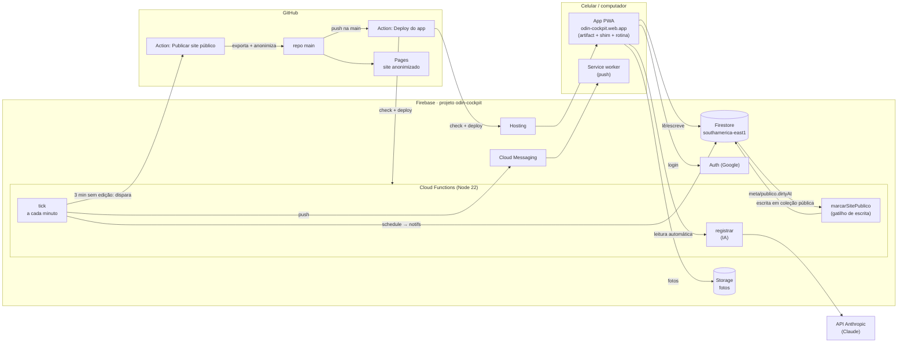

# Arquitetura

## As peças

| Peça | Onde | O que faz |
|---|---|---|
| **Cockpit** | `artifact/index.html` | Toda a interface: Hoje, Registrar, Evolução, Histórico, Mais. Funciona em três modos: artefato do Claude, app com Firebase e site estático (`window.ODIN_STATIC`). |
| **Shim** | `app/src/shim.js` | Faz o cockpit falar com o Firebase sem mudar o código dele. `window.claude.use('db')` vira Firestore, `'assets'` vira Storage, `'sample'` vira a função `registrar`. Também cuida do login e do aviso de versão nova. |
| **Rotina e Admin** | `app/src/rotina.js` | Lembretes pendentes (em Hoje), registro do dia a dia (em Registrar), horários e push (em Mais → Lembretes), acesso, metas, alimentos e notificações (em Mais → Admin). |
| **Build** | `scripts/build-app.mjs` | Copia o cockpit e injeta o que é só do app: meta `odin-build`, manifest, painéis Lembretes e Admin, scripts do Firebase. |
| **tick** | `functions/index.js` | A cada minuto: cria lembretes a partir de `schedule` (remédio pausado ou fora do período não lembra), calcula o "próximo lado" do decúbito e quanto falta de água, avisa compromissos e estoque, reenvia o que ficou pendente 15 min e dispara a publicação do site. |
| **registrar** | `functions/index.js` | Chamada autenticada (só admin/edita). Manda texto e imagens pro Claude e devolve o JSON que o cockpit mostra em "Confere antes de salvar". |
| **marcarSitePublico** | `functions/index.js` | Gatilho do Firestore. Toda escrita numa coleção que vai pro site marca `meta/publico.dirtyAt`. |
| **Deploy do app** | `.github/workflows/deploy-app.yml` | No push pra `main`: instala, roda `npm run check` (o mesmo de antes do commit) e faz deploy de hosting, regras e funções. |
| **Publicar site público** | `.github/workflows/publicar-site.yml` | Exporta do Firestore, anonimiza, monta `docs/` e commita se mudou. Quem dispara é o `tick`; o cron a cada 6 h é só rede de segurança. |

## Caminho de um dado

1. Elis marca "Dei os marcados ✓" num lembrete em **Hoje**.
2. `rotina.js` grava um `rotina_log` por remédio (dado ou pulado) e atualiza o `notifs` daquele horário.
3. O Firestore avisa todo mundo conectado (`onSnapshot`), e as outras telas abertas atualizam na hora.
4. Se o dado é de uma coleção pública (ex.: `vitals`), `marcarSitePublico` marca o site como desatualizado.
5. Três minutos sem novas edições, o `tick` dispara a Action, e o site público sai atualizado e anonimizado.

## Por que assim

As decisões e alternativas estão nos [ADRs](decisoes/). Resumindo:

- **Um HTML só** pra app e site evita duas interfaces divergindo ([ADR 0002](decisoes/0002-artefato-fonte-unica.md)).
- **Firebase** dá login, banco em tempo real, push e funções agendadas sem servidor pra manter ([ADR 0001](decisoes/0001-firebase.md)).
- **O site público** é gerado e anonimizado num lugar só, e quem dispara é a mudança de dado ([ADR 0003](decisoes/0003-site-publico-anonimizado.md)).
