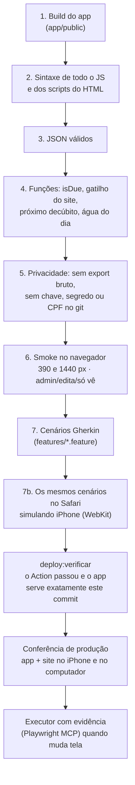

# Qualidade e testes

Toda mudança passa pelo mesmo portão, **antes do commit e de novo no CI**: `npm run check`. Ele para no primeiro ✗, e a regra é não desligar checagem pra passar.



## As camadas

| Camada | Arquivo | Pega o quê | Tempo |
|---|---|---|---|
| Estática | `scripts/check.mjs` (passos 1–5) | Erro de sintaxe, JSON quebrado, segredo vazado, regra de horário errada | ~3 s |
| Smoke | `tests/smoke.mjs` | Tela que estoura a largura, erro de JavaScript, fluxo quebrado em qualquer papel | ~60 s |
| Comportamento | `features/*.feature` + Page Objects + passos | Regra de negócio escrita como a pessoa fala, conferida na tela | ~40 s |
| Safari / iPhone | os mesmos cenários com `NAVEGADOR=webkit` (perfil iPhone 15) | Diferença de comportamento do Safari | ~40 s |
| Site público | `features/site-publico.feature` (`@site`), sobre um site gerado do seed pelo mesmo `publicar.mjs`; no Action de publicar, sobre o site real antes do commit | Seção de registro aparecendo, dado pessoal, erro no console, tela estourando | ~15 s |
| Produção | `scripts/verificar-deploy.mjs` + `scripts/conferir-producao.mjs` | Deploy que falhou em silêncio, cache servindo versão velha, erro de JS ou layout quebrado no ar (iPhone e computador) | até alguns minutos |
| Aceite com evidência | Playwright MCP (qa-test-executor) no modo teste, 390 × 844 | O que só se vê olhando: a tela de verdade, com print | por cenário |

**O que nenhuma camada pega:** o teclado e a barra de status de um iPhone de verdade. Bug achado no aparelho vira cenário, como o "Ok, visto" do aviso de compra (18/11).

O smoke e os cenários rodam o **app de verdade** (`app/public`) num Chromium, com um Firebase falso (`tests/fakefb.js`) e dados de teste (`tests/seed.mjs`). Nada toca o Firebase real.

## Cenários em Gherkin (método lunarpass-tests / Método ADT)

Os cenários seguem as skills de QA do método **lunarpass-tests**:

| Skill | Como foi aplicada aqui | Onde está |
|---|---|---|
| `qa-gherkin-design` | Análise dos pedidos (explícito, derivável, a investigar), variantes, técnicas, Gherkin **declarativo em 1ª pessoa** com **Ilustração:**, e perguntas pros Três Amigos | [especificacao.md](especificacao.md) e `features/*.feature` |
| `qa-testability-audit` | Parecer por elemento com a escada de locator. A interface ganhou papéis e nomes acessíveis | [aderencia.md](aderencia.md) |
| `qa-test-automation` | Page Objects (`features/support/paginas.mjs`), locators `getByRole → getByLabel → …`, `expect` que espera sozinho, **sem `waitForTimeout`**, uma asserção por **Então**, massa isolada por cenário | `features/steps/passos.mjs` |
| `qa-test-executor` | Execução com o Playwright MCP (Chrome visível no Mac) contra o **modo teste** (`/teste/`, Firebase falso), com evidência em PNG e um relatório por cenário | [execucoes/](execucoes/) |

Exemplo:

```gherkin
Funcionalidade: Responder os lembretes do dia

  Contexto:
    Dado que eu posso registrar os cuidados do Odin
    E há lembretes pendentes para hoje

  Cenário: Remédio pulado pode ser registrado como dado depois
    Ilustração: pulado às 09:30, dado às 11:28.
    Dado que eu pulei um remédio no lembrete da manhã
    Quando eu informo que dei esse remédio mais tarde
    Então ele aparece como dado no horário que eu informei
    E ele não aparece mais como pulado
```

| Arquivo | Cobre |
|---|---|
| `navegacao.feature` | As 5 seções, embaixo no celular e em cima no computador, cada parte cabendo na tela, aviso de lembrete levando pra Hoje |
| `registrar.feature` | Comida por unidade nas calorias, remédio fora de hora, peso, xixi, consulta no calendário |
| `lembretes.feature` | Água de coco pela fração de água, bloco dado/pulado, "Dei depois", pular |
| `notificacoes.feature` | Ligar decúbito e água cria horários; desligar compras fica guardado |
| `permissoes.feature` | Quem só acompanha não registra; Admin só pra quem administra (esquema) |
| `medicamentos.feature` | "Já usou" recolhido, pausar com motivo, retomar com histórico |

### Como rodar

```bash
npm run bdd                                        # monta o app e roda todos os cenários
npx cucumber-js features/registrar.feature         # um arquivo
npx cucumber-js --name "Peso registrado"           # um cenário
```

O relatório HTML sai em `relatorios/cenarios.html`. Cenário que falha anexa a captura de tela. Erro de JavaScript na página também faz o cenário falhar.

### Como escrever um cenário novo

1. **Especifique antes de automatizar.** Analise o pedido: o que é explícito, o que é derivável (vira *hipótese*) e o que está a investigar (vira pergunta em `especificacao.md`, nunca cenário). Não invente regra.
2. **Escreva declarativo, em 1ª pessoa, no nível do negócio.** "Quando eu informo que dei esse remédio mais tarde", e nunca "clico em Dei depois e preencho 11:28". Valor que só ilustra vai em `Ilustração:`.
3. **Um comportamento por cenário.** O nome do cenário diz a regra.
4. **Automatize pelo Page Object.** Ação nova vira método em `features/support/paginas.mjs`, com locator da escada. Se não houver papel ou nome bom, ajuste a interface (`aria-label`, `role`) e registre em `aderencia.md`.
5. **Asserção pela tela, com `expect` que espera.** Nada de `waitForTimeout`. O valor esperado vem do catálogo ou da massa, não de número fixo.
6. **Massa** em `tests/seed.mjs`, compartilhada com o smoke. Cada cenário abre o app do zero.
7. Rode `npm run bdd` umas 3 vezes pra garantir que não é instável. Depois `npm run check`.

## Quando algo falha no CI

O Action "Deploy do app (Firebase)" roda o mesmo `npm run check`. Se ele falhar, nada vai pro ar. Abra o link que o `npm run deploy:verificar` mostra, leia o primeiro ✗ e reproduza local com `npm run check`.
