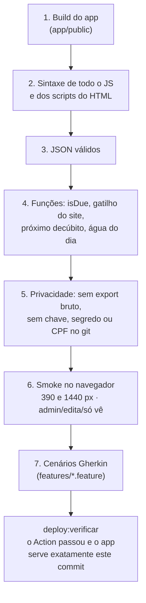

# Qualidade e testes

Toda mudança passa pelo mesmo portão, **antes do commit e de novo no CI**: `npm run check`. Ele para no primeiro ✗, e a regra é não desligar checagem pra passar.



## As camadas

| Camada | Arquivo | Pega o quê | Tempo |
|---|---|---|---|
| Estática | `scripts/check.mjs` (passos 1–5) | Erro de sintaxe, JSON quebrado, segredo vazado, regra de horário errada | ~3 s |
| Smoke | `tests/smoke.mjs` | Tela que estoura a largura, erro de JavaScript, fluxo quebrado em qualquer papel | ~60 s |
| Comportamento | `features/*.feature` + `features/steps/passos.mjs` | Regra de negócio escrita como a pessoa fala ("remédio dado fora de hora grava só o que foi marcado") | ~50 s |
| Produção | `scripts/verificar-deploy.mjs` | Deploy que falhou em silêncio, cache servindo versão velha | até alguns minutos |

O smoke e os cenários rodam o **app de verdade** (`app/public`) num Chromium, com um Firebase falso (`tests/fakefb.js`) e dados de teste (`tests/seed.mjs`). Nada toca o Firebase real.

## Cenários em Gherkin

Os cenários ficam em `features/`, escritos em português (`# language: pt`). Cada um descreve um comportamento que importa pra quem usa:

```gherkin
Funcionalidade: Registrar tudo num lugar só

  Contexto:
    Dado que sou quem edita no celular
    E abro o app
    E vou para "Registrar"

  Cenário: Comida por unidade vira gramas e calorias
    Quando toco em "Comida"
    E escolho "Biscrok Multi" em "Alimento"
    E preencho "Quanto (g ou unidades)" com "2"
    E salvo
    Então fica registrado 2 Biscrok, 20 g e 68 kcal
```

| Arquivo | Cobre |
|---|---|
| `navegacao.feature` | As 5 seções, barra embaixo no celular, cada painel cabendo na tela, links antigos |
| `registrar.feature` | Comida por unidade, remédio fora de hora, peso, xixi, agendar consulta |
| `lembretes.feature` | Água de coco a 95%, bloco dado/pulado, "Dei depois", pular |
| `notificacoes.feature` | Admin liga decúbito e água e desliga compras |
| `permissoes.feature` | Só vê sem Registrar; Admin só pra admin (esquema com exemplos) |
| `medicamentos.feature` | "Já usou" recolhido, pausar e retomar com histórico |

### Como rodar

```bash
npm run bdd                         # monta o app e roda todos os cenários
npx cucumber-js features/registrar.feature            # um arquivo
npx cucumber-js --name "Peso vira uma pesagem"        # um cenário
```

O relatório HTML sai em `relatorios/cenarios.html`. Cenário que falha anexa uma captura de tela.

### Como escrever um cenário novo

1. **Comece pela frase de quem usa**, não pela tela: "Quando respondo o lembrete de Água com 150 mL de Água de coco", e não "Quando clico no botão #rn-s2".
2. **Um comportamento por cenário.** Se precisar de "e também", provavelmente são dois.
3. **Reaproveite os passos** que já existem em `features/steps/passos.mjs`. Pra ver os que faltam, rode `npx cucumber-js --dry-run`: ele sugere o esqueleto do passo.
4. **Confira no dado, não só na tela.** Os passos "Então" leem `window.__store` (o Firebase falso) pra garantir que gravou certo.
5. **Dado de teste novo** vai em `tests/seed.mjs`, que smoke e cenários compartilham.
6. Rode `npm run check`. Só com tudo ✓ segue pra commit.

## Quando algo falha no CI

O Action "Deploy do app (Firebase)" roda o mesmo `npm run check`. Se ele falhar, nada vai pro ar. Abra o link que o `npm run deploy:verificar` mostra, leia o primeiro ✗ e reproduza local com `npm run check`.
