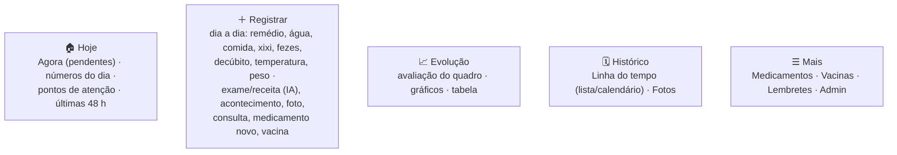

# UX e navegação

## O problema (novembro de 2026)

O cockpit cresceu por pedido, uma funcionalidade de cada vez, organizado pelo **tipo de dado**: Painel, Rotina, Exames, Medicamentos, Vacinas, Fotos, Linha do tempo, Admin. Uma auditoria no tamanho de celular (375 × 812) achou:

- **5 lugares diferentes pra registrar algo**: Rotina, Painel (leitura automática e "acontecimento rápido"), Linha do tempo, Vacinas e Fotos.
- **"Como ele está" espalhado**: água e calorias no Painel e na Rotina, gráficos em Exames, a avaliação no meio do Painel.
- **Menu de 8 abas em 3 linhas**, fixo no topo: 154 px, 19% da tela do iPhone.
- **Painel com ~6 telas de rolagem**; o "Registrar" ficava no fim.
- **Instrução obsoleta** (exportar JSON e rodar comando no terminal) quando a publicação já era automática.
- **Medicamentos com 50 itens** e 178 botões na tela, 28 deles de remédios que ele já não usa.

A própria dona do projeto, que usa o app toda hora, se perdia.

## O princípio: organizar pela tarefa, não pelo dado

Quem cuida do Odin chega no app com uma de poucas perguntas:

| Pergunta | Seção |
|---|---|
| "O que eu tenho que fazer agora?" | **🏠 Hoje** |
| "Quero anotar uma coisa" | **＋ Registrar** |
| "Como ele está? Está melhorando?" | **📈 Evolução** |
| "O que aconteceu naquele dia?" | **🗓 Histórico** |
| "Qual é mesmo a dose / a vacina / o horário?" | **☰ Mais** |

## Regras de interface

1. **Um lugar pra lançar.** Todo formulário mora em Registrar. Nas outras telas só existe atalho ("＋ Anotar peso", "＋ Agendar"), e ele leva pra lá.
2. **Polegar primeiro.** No celular (≤ 760 px) as 5 seções ficam numa barra embaixo, com o ＋ no meio. No computador, abas em cima.
3. **O urgente em cima.** Hoje começa pelo que está pendente, e o número de pendentes aparece como bolinha no ícone de Hoje.
4. **Formulário curto.** Lembrete mostra só o essencial ("Dei ✓ / Pulei"). Hora e observação ficam em "mudar hora ou anotar".
5. **Recolher o que é passado.** "Já usou" vem fechado, e em Medicamentos o que está em uso vem antes da linha do tempo.
6. **Nada de caixa de diálogo do navegador.** `prompt`/`confirm` são bloqueados no app instalado no iPhone. Confirmação é com dois toques ("toque de novo pra confirmar"), e os avisos são um toast.
7. **Cada papel vê o que pode fazer.** Quem só vê não tem o botão Registrar, e Admin só aparece pra admin. A proteção de verdade está nas regras do Firestore.
8. **Links antigos continuam funcionando.** `#rotina` (usado nos pushes) e `#painel` caem em Hoje.

## Como a navegação funciona no código

- `SECTIONS` (em `artifact/index.html`) diz quais painéis (`p-<id>`) compõem cada seção. Seção com mais de um painel ganha as sub-abas (`#subtabs`).
- `go(alvo)` aceita uma seção (`mais`), um painel (`remedios`) ou um nome antigo (`rotina`). Ele lembra o último painel de cada seção.
- `openReg(tipo)` abre só o formulário daquele tipo em Registrar. Os botões com `data-reg` (ou `data-free`, pros registros da rotina) funcionam de qualquer tela.
- O app acrescenta Lembretes e Admin em "Mais" no build (`scripts/build-app.mjs`), e `window.panelHidden` esconde Admin pra quem não é admin.

Os cenários que garantem tudo isso estão em [`features/navegacao.feature`](../features/navegacao.feature) e [`features/permissoes.feature`](../features/permissoes.feature).
